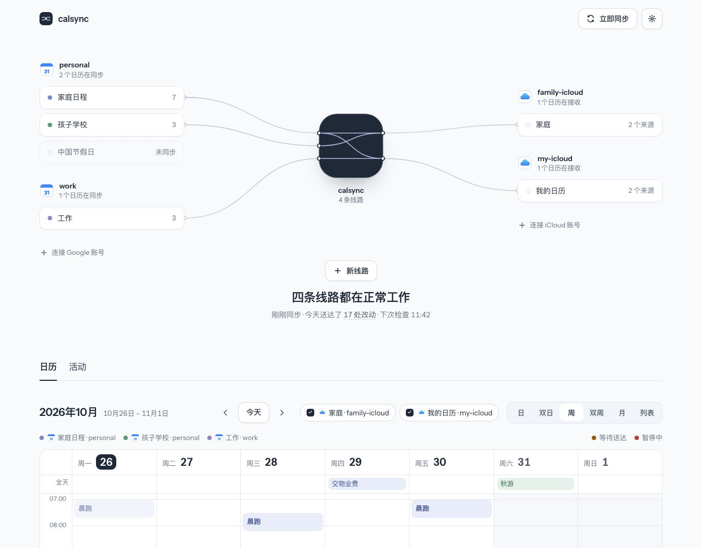

# calsync

**One-way calendar sync that you host yourself.** calsync keeps a CalDAV
calendar (iCloud, iCloud China, Radicale, …) continuously in step with a
Google Calendar — events, recurrence, per-instance changes and alerts — and
never touches anything it did not create.

```
Google Calendar ──► calsync (your machine) ──► iCloud / any CalDAV ──► iPhone, Mac, …
   you write here       incremental, safe         people read here
```

> **Status: early.** The sync engine, the `calsync` command line (with
> `--json` for scripts and [AI agents](docs/agent-cli.md)), the
> `calsync daemon` background process with push notifications, and the
> launchd service installer are complete and tested, and so is the web UI (the
> sync map, the calendar, activity and settings). With write access, calsync
> also creates, changes (by form or by dragging) and deletes the Google
> originals, from the web UI or the command line, and agents can write many
> events in one idempotent batch (see [Roadmap](docs/ROADMAP.md)).

---

## Contents

- [Why](#why)
- [Features](#features)
- [How it works](#how-it-works)
- [What calsync writes into your calendars](#what-calsync-writes-into-your-calendars)
- [Quick start](#quick-start)
- [Upgrading](#upgrading)
- [Configuration](#configuration)
- [Running as a daemon](#running-as-a-daemon)
- [Notifications](#notifications)
- [Web UI](#web-ui)
- [Command line](#command-line)
- [Safety guarantees](#safety-guarantees)
- [Privacy and security](#privacy-and-security)
- [Known limitations](#known-limitations)
- [Troubleshooting](#troubleshooting)
- [Development](#development)
- [License](#license)

## Why

Google calendars can only be shared with Google accounts and iCloud calendars
only with Apple IDs, so a calendar you maintain in Google — for example
through an AI assistant connected to Google Calendar — cannot simply appear in
an iCloud calendar (yours, or anyone's you write to). ICS subscription links are read-only, refresh
slowly and drop alerts.

calsync bridges the gap one way: keep writing in Google, and the events show
up, with their alerts, in an iCloud calendar that you can share or that lives
directly in the other person's account.

## Features

| | |
| --- | --- |
| **Sources** | Google Calendar (official REST API, incremental `syncToken` sync) |
| **Targets** | iCloud — global and China mainland, detected automatically · Radicale · other CalDAV servers (standards-based; untested so far) |
| **What is synced** | title, description (HTML converted to text), location, start/end with time zones, all-day events, recurrence rules, exceptions and per-instance changes, cancelled instances, free/busy, **alerts** (pop-up reminders), conference links, and the attendee list as text in the notes |
| **What is never synced** | attendees and organizer as real participants — so a target server can never send invitations on your behalf; Google e-mail reminders |
| **Full sync by default** | every event, past and future; optionally limit a rule to a time window such as the last 7 days and the next 180 days |
| **Edits on the target are reverted** | an event changed on the iPhone (or any CalDAV client) is written back to the Google version on the next cycle, and a deleted copy is re-created — sync stays strictly one way |
| **Field policy per rule** | attendees listed in the notes or left out, conference link copied or left out, or a busy-only mode that writes just "Busy", the times and the alerts (see [`fields`](#rules)) |
| **Alert policy per rule** | copy Google's alerts, strip them, or replace them with fixed offsets such as `["-5m", "0m"]` |
| **Many-to-many** | any number of accounts and rules; one source can feed several targets |
| **Cheap when idle** | an unchanged cycle costs one request per Google account, one per source calendar and one per target calendar — enforced by the test suite |
| **Safe by construction** | only touches events it created, mass-delete guard, keeps the last good copy when source data is malformed (see [Safety guarantees](#safety-guarantees)) |
| **Credentials** | macOS Keychain, environment variables, or 0600 files; verified before they are stored |
| **Proxies** | honours `HTTPS_PROXY` / `HTTP_PROXY` / `NO_PROXY` |
| **Runs in the background** | `calsync daemon` with hot reload of the config file; `calsync service install` sets it up as a launchd agent |
| **Tells you when it needs you** | Bark and webhook pushes for expired sign-ins, blocked deletes, repeated failures and recovery |
| **Agent friendly** | every command has `--json`; configuration changes are validated, backed up, recorded and undoable; see the [agent guide](docs/agent-cli.md) |

## How it works

```
                 ┌──────────────────────── one sync cycle ────────────────────────┐
 Google API ───► │ 1 pull     incremental delta per source calendar → local mirror │
                 │ 2 detect   CalDAV change check per target calendar              │
                 │            (sync-collection, then getctag, then a listing);     │
                 │            changed copies of our own events are read back       │
                 │ 3 plan     desired (the mirror, or the part inside the rule's   │
                 │            window) vs. actual (managed events in the target)    │
                 │            → create / update / delete; edited copies → revert   │
                 │ 4 guard    block suspicious mass deletes                        │
 CalDAV ◄─────── │ 5 push     conditional writes (If-None-Match / If-Match)        │
                 │ 6 record   run history in a local SQLite file                   │
                 └─────────────────────────────────────────────────────────────────┘
```

- Every event calsync writes has a deterministic resource name,
  `calsync-<rule>-<id>.ics`. Ownership is visible from a listing alone, so
  calsync never needs to read — let alone modify — your other events (see
  [What calsync writes into your calendars](#what-calsync-writes-into-your-calendars)).
- When one of its own events changed on the target, calsync reads it back and
  compares what a person sees — times, title, notes, location, link,
  recurrence, free/busy, alerts — with the version it would write. If they
  differ, the source version is written back. Bookkeeping that servers and
  phones add on their own (stamps, sequence numbers, private `X-` properties,
  a dismissed or snoozed alert) is not an edit and is never undone. A copy
  that still shows exactly the source version is never rewritten, even if
  the phone dropped or changed calsync's hidden marker; a check on a real
  iPhone is pending. Reverting does not depend on that marker either: calsync
  remembers what it wrote, so an edit is reverted whether or not the phone
  keeps the marker (only after the local state was lost does a copy without
  the marker that differs count as an ordinary update instead of a revert).
- If a copy keeps changing on the target right after calsync writes it (a
  server or app that rewrites events on its own), calsync stops reverting
  that copy after three reverts within six hours, for 24 hours, and logs one
  warning naming the rule and the event's internal id. Changes made in
  Google are still written meanwhile. When the 24 hours are over, calsync
  writes the Google version back once (reported as `reverted=1`, without an
  edit on the target being needed); if the target rewrites it again, the
  same rule applies.
- The local sync state (mirror, cursors, target cache) is a **rebuildable
  cache**. Delete the state directory and the next run reconciles from both
  ends without creating duplicates. The same directory also holds what
  cannot be rebuilt: the run and change history (approvals included), the
  config history behind `calsync config undo`, and the web UI's pairing key
  `web.key` (every browser has to pair again).
- A recurring series with many individually edited instances is written as one
  iCalendar resource with `RECURRENCE-ID` overrides, each carrying its own
  alerts.

The full design lives in [`docs/superpowers/specs/2026-10-23-calsync-design.md`](docs/superpowers/specs/2026-10-23-calsync-design.md).

## What calsync writes into your calendars

Each Google event — a recurring series with all its per-instance changes
counts as one — becomes one iCalendar resource in the target calendar:

- **Resource name** `calsync-<rule>-<id>.ics`, where `<rule>` is a short tag
  (8 hex digits) derived from the rule name and `<id>` (24 hex digits) is
  derived from the rule name, the source calendar and the Google event ID.
  This name is how calsync recognises its own events: it only ever reads,
  changes or deletes resources it named. Everything else in the calendar —
  events you or other apps created — is never touched.
- **`UID`** `<id>@calsync`.
- **Two hidden properties** on every event (calendar apps do not display
  `X-` properties):
  - `X-CALSYNC-RULE` — the name of the rule that wrote the event, so you can
    tell where a copy came from when you look at its raw data. calsync itself
    decides ownership by the resource name, not by this property.
  - `X-CALSYNC-HASH` — a fingerprint of the source version that was written.
    When the local state is rebuilt, calsync reads it back to know which
    copies are already current, so they are not rewritten. Edits made on the
    target are found by comparing the visible content instead, so they are
    caught whether or not the editing app keeps this property.
- **The event itself:** title, notes, location, start and end (with
  `VTIMEZONE`s), recurrence (`RRULE`, `EXDATE`, `RDATE`, `RECURRENCE-ID`
  overrides), free/busy, and one display alert per reminder. With the default
  [`fields`](#rules), the notes are the Google description followed by
  `Attendees: Name <email>, …` and `Conference: <url>`, each block separated
  by a blank line, and the conference link is also the event's `URL`. With
  `content = "busy"` the title is `Busy` and there are no notes, location or
  `URL`; times, free/busy and alerts are kept.
- **Never written:** `ATTENDEE` or `ORGANIZER` (so no server sends
  invitations), meeting rooms and other resources, Google e-mail reminders.

## Quick start

You need Python 3.12+ and [uv](https://docs.astral.sh/uv/). About 15 minutes,
most of it in the Google console.

### 1. Install

```sh
uv tool install git+https://github.com/Aryous/calsync
calsync --version
```

### 2. Create a Google OAuth client (once)

calsync reads your calendars with your own Google Cloud OAuth client:

1. Open the [Google Cloud console](https://console.cloud.google.com/), create a
   project, and enable the **Google Calendar API**.
2. Configure the **OAuth consent screen** (External), add yourself, then
   **publish it to "In production"**. While it stays in "Testing", Google
   expires refresh tokens after 7 days and sync stops.
3. Create credentials → **OAuth client ID** → application type **Desktop app**,
   and download the JSON file.
4. Put it where calsync looks for it:

   ```sh
   mkdir -p ~/.config/calsync
   cp ~/Downloads/client_secret_*.json ~/.config/calsync/google-client.json
   chmod 600 ~/.config/calsync/google-client.json
   ```

Personal use needs no Google verification; you will see an "unverified app"
warning when you sign in (choose *Advanced → continue*). `calsync auth
<account>` asks for read-only calendar access. To create, change and delete
events from calsync (the web UI's 修改 and 新建日程, `calsync event …`), give it
write access once: `calsync auth <account> --write` (Google's page then asks
for both; keep the box for changing events ticked). calsync never revokes a
grant: revoking a token of the shared OAuth client would also cut off every
other token of that client and account.

### 3. Create an iCloud app-specific password

Apple does not offer OAuth for CalDAV. Go to
[account.apple.com](https://account.apple.com) → *Sign-In and Security* →
*App-Specific Passwords* and create one named `calsync`.

### 4. Write the configuration

`~/.config/calsync/config.toml`:

```toml
[google]
client_secret_file = "~/.config/calsync/google-client.json"

[accounts.me-google]
provider = "google"
credential = { backend = "keychain", ref = "calsync/me-google" }

[accounts.me-icloud]
provider = "caldav"
server_url = "icloud"              # detects the global or China mainland region
username = "you@icloud.com"        # your Apple ID
credential = { backend = "keychain", ref = "calsync/me-icloud" }

[[rules]]
name = "family"
source = { account = "me-google", calendar = "Family" }      # name or calendar ID
target = { account = "me-icloud", calendar = "Family", create_if_missing = true }
```

```sh
calsync config check
```

You can also build the file from the command line: `calsync account add`
and `calsync rule add` write the same tables (see
[Changing the configuration](#changing-the-configuration)).

### 5. Sign in

```sh
calsync auth me-google     # opens your browser for Google sign-in
calsync auth me-icloud     # prompts for the app-specific password
```

Both commands verify the credential before storing it and keep the previous
one if verification fails.

### 6. Look, then sync

```sh
calsync calendars me-google    # IDs, names and your role in each Google calendar
calsync calendars me-icloud    # your iCloud calendars (their URLs and names)
calsync run --dry-run          # print what would be created / updated / deleted
calsync run                    # one sync cycle
```

`calendars` prints when the list was fetched, then one line per calendar
(ID or URL, name, and for Google your access role). The list is cached;
`--refresh` fetches it again.

### 7. Keep it running

```sh
calsync daemon                 # syncs now, then every minute, until Ctrl-C
```

To start it at login and keep it running (macOS), install it as a launchd
agent:

```sh
calsync service install        # writes ~/Library/LaunchAgents/dev.calsync.daemon.plist and loads it
calsync service status         # installed? loaded? its pid and last exit code
```

See [As a launchd service](#as-a-launchd-service-macos) and
[Running as a daemon](#running-as-a-daemon). Set up
[notifications](#notifications) so you hear when it needs you.

## Upgrading

```sh
uv tool install --reinstall git+https://github.com/Aryous/calsync
calsync config check
calsync run --dry-run          # review before the first real cycle (needs the daemon stopped)
```

A running daemon keeps running the old version until it restarts. If it runs
as a service, restart it with `calsync service uninstall` and
`calsync service install` (the uninstall waits for a running cycle to
finish).

**Skipping versions?** Then every section below for a version newer than
yours applies, not only the first. A state database older than schema 3
(an install from before full sync and reverts) has no upgrade path: it is
rebuilt once. That first cycle is heavy (every source calendar pulled from Google in
full, every copy in the target calendars read once), the run, change and
alert history is lost, and nothing is duplicated (copies are adopted by
their resource names). Deletes the rebuilt state plans still go through the
mass-delete guard: after such an upgrade, check `calsync blocked` before
you approve anything, and approve only a set you understand. The
`calsync run --dry-run` above already performs the rebuild (it opens the
state database), so its cycle is the heavy one.

### Upgrading to the version with configuration commands, notifications and the service

- **The state database is migrated in place** (schema 5) from schema 3 or 4
  (the versions with the daemon). Run and change history are kept and the
  first cycle costs no more than any other. An older database is rebuilt
  instead (see "Skipping versions" above). What
  calsync wrote for each copy is recorded from now on, so the change details
  (`calsync changes --json`, `calsync event show`) start with the upgrade.
- **Going back to an older calsync rebuilds its state database.** An older
  version does not know the new schema, so it starts from an empty state:
  one heavy cycle (no duplicates), and the run history, the change history
  and the config history (`calsync config history`) are lost.
- **`calsync service install` replaces a hand-written launchd plist.** If you
  wrote `~/Library/LaunchAgents/dev.calsync.daemon.plist` yourself (as an
  earlier version of this README said), `calsync service install` shows how
  it differs and stops (exit 2); `calsync service install --force` boots the
  old agent out (waiting for a running cycle to finish), writes its own plist
  and loads it. Another launchd job that runs calsync (an old `StartInterval`
  agent running `calsync run`, say) is reported and stops the install (exit
  4): unload it first. The daemon's log is now
  `~/Library/Logs/calsync/daemon.log`.
- **Notifications are off until you configure a channel** (see
  [Notifications](#notifications)). Their texts are Chinese by default; set
  `notify.language` to `"en"` for English.

### Upgrading to the version with the daemon and the web UI

- **The state database is migrated in place.** Run history, cursors and the
  cached copies are kept, so the first cycle after the upgrade costs no more
  than any other. Change history (`calsync changes`) starts with the upgrade:
  an event synced before it and deleted later is listed without its title.
- **The daemon replaces a scheduled `calsync run`.** If a `StartInterval`
  agent ran `calsync run` before, unload it before you load the daemon (see
  [Keep it running](#7-keep-it-running)): while the daemon runs, `calsync run`
  exits with code 4.

### Upgrading to the version with full sync and reverts

The first `calsync run` after this upgrade is a one-time heavy cycle; the
cycles after it are back to the idle cost.

- **Every managed event is read once.** The local state format changed, so
  the state database is rebuilt from both ends (no duplicates, as after any
  state loss). The rebuild also clears the local run history.
- **Every source calendar is pulled from Google in full once.** calsync now
  asks Google for attendees and conference links, and a change of request
  fields always starts a fresh full pull.
- **Only events whose visible content changed are rewritten.** The written
  format changed (for example the new `URL` and the attendee and conference
  lines in the notes). Each copy read during the rebuild is compared with what
  calsync would write now; a copy that already shows exactly that is kept as
  it is, so its snoozed or dismissed alerts stay. Events with attendees or a
  conference link are rewritten once.
- **Rules without `window` now sync everything.** A rule from an older
  configuration that had no `window` used to keep the last 7 days and the
  next 180 days; it now creates the older and later events too. To keep the
  old range, set `window = {}`. On its first full-sync cycle such a rule may
  also delete leftover copies whose Google event was deleted after the copy
  had left the old window. These deletes go through the mass-delete guard
  like any other: if the guard blocks the cycle, check the printed titles and
  use `--allow-deletes`.

## Configuration

Location: `~/.config/calsync/config.toml`, or the path in `$CALSYNC_CONFIG`
or `--config`. Relative paths inside the file are resolved against the file's
directory. Every problem in the file is reported at once.

### `[google]`

| Key | Required | Meaning |
| --- | --- | --- |
| `client_secret_file` | when any Google account exists | the OAuth client JSON downloaded from Google Cloud |

### `[accounts.<name>]`

| Key | Default | Meaning |
| --- | --- | --- |
| `provider` | — | `"google"` (source) or `"caldav"` (target) |
| `credential` | — | `{ backend = "keychain" \| "env" \| "file", ref = "…" }` — keychain entry name, environment variable name, or path to a 0600 file |
| `server_url` | — | caldav only: `"icloud"` (auto-detects global or China mainland) or any `http(s)://` CalDAV URL |
| `username` | — | caldav only: the login, e.g. your Apple ID |
| `max_concurrency` | `2` | caldav only: parallel writes; drops to 1 for the rest of a cycle when the server throttles |

### `[[rules]]`

| Key | Default | Meaning |
| --- | --- | --- |
| `name` | — | unique; part of every resource the rule writes (see [Known limitations](#known-limitations)) |
| `source` | — | `{ account = "…", calendar = "<name or ID>" }`; names are matched against the display name you see in Google |
| `target` | — | `{ account = "…", calendar = "<name or URL>", create_if_missing = false }` |
| `window` | omitted: every event, past and future | optional `{ past = "…", future = "…" }`: only events overlapping this range around now are kept in the target; a key left out means `past = "7d"` / `future = "180d"`, so `window = {}` is the last 7 days and the next 180 days |
| `alarms` | `"copy"` | `"copy"`, `"strip"`, or a list of offsets such as `["-5m", "0m"]` |
| `fields` | `{ attendees = "notes", conference = "copy", content = "full" }` | what of each event reaches the target; see below |
| `on_target_edit` | `"revert"` | the only value: an edit made on the target is written back to the source version on the next cycle, and a copy deleted on the target is re-created |
| `delete_guard` | `{ max_ratio = 0.5, max_count = 10 }` | block a cycle that would delete more than `max_count` events, or (from 3 deletions on) more than `max_ratio` of the rule's events |
| `paused` | `false` | `true`: no cycle syncs the rule (`calsync pause` / `resume` set it) |
| `retire` | `false` | `true`: the rule deletes its copies (through the delete guard), then calsync removes it from the file (`calsync rule remove --delete-copies` sets it) |

`fields` — every key is optional:

| Key | Values | Default | Meaning |
| --- | --- | --- | --- |
| `attendees` | `"none"`, `"notes"` | `"notes"` | `"notes"`: append `Attendees: Name <email>, …` to the notes (a person with only a name or only an address is listed by that). Attendees are never written as invitees, so no invitations are sent. `"none"`: leave them out |
| `conference` | `"copy"`, `"none"` | `"copy"` | `"copy"`: the video meeting link becomes the event's `URL` and a `Conference: <url>` line in the notes. `"none"`: leave it out |
| `content` | `"full"`, `"busy"` | `"full"` | `"busy"`: title `Busy`, no notes, location or link; times, recurrence, free/busy and alerts are kept — e.g. to show a work calendar in a personal one |

```toml
[[rules]]
name = "work-busy"
source = { account = "me-google", calendar = "Work" }
target = { account = "me-icloud", calendar = "Work (busy)", create_if_missing = true }
window = { past = "7d", future = "90d" }
fields = { content = "busy" }
```

Changing `alarms` or `fields` rewrites the events it affects once, on the
next cycle.

Durations are written as `30s`, `5m`, `2h`, `7d`, `1w`, with an optional sign.

`[runtime]` sets the daemon's schedule: `interval` (default `60s`) and
`jitter` (default `0.1`, so each wait is 54–66 s). `[notify]` sets the push
channels (`bark_url`, `webhook_url`, `public_url`, `failure_threshold`,
`language`; see [Notifications](#notifications)).

`[web]` sets where the daemon serves the [web UI](#web-ui):

```toml
[web]
listen = "127.0.0.1:8766"              # HOST:PORT (default); an IPv6 host in brackets: "[::]:8766"; "off": no web UI
allowed_hosts = ["mac-mini.local"]     # other names the browser may use for this machine
```

### Changing the configuration

You can edit the file by hand, or change it with commands that keep its
comments and layout:

```sh
calsync config get                              # the parsed config as JSON (URLs and logins masked; --reveal)
calsync config set runtime.interval 2m          # one setting; an empty value removes it
calsync config set notify.bark_url https://api.day.app/YOUR_KEY
calsync rule add work --source me-google:Work --target me-icloud:Work --create-target --preview
calsync rule add work --source me-google:Work --target me-icloud:Work --create-target --content busy
calsync rule set work window 30d:365d           # also alarms, fields.*, delete_guard.*, paused
calsync rule remove work [--delete-copies]
calsync pause family                            # no cycle syncs it until: calsync resume family
calsync account add kid-icloud --provider caldav --server-url icloud --username kid@icloud.com
calsync account remove kid-icloud
calsync config history                          # who changed what, newest first
calsync config undo                             # undo the newest change not yet undone
```

- Every command that changes the file takes `--dry-run` (validate and show
  the diff, write nothing) and `--json`. The new text is validated as a whole
  (the same checks as `config check`) before it is written; the previous file
  is kept as `config.toml.bak`, and the new one replaces it atomically.
- A change is refused if the file changed since calsync read it ("the file
  was changed outside calsync; reload and try again"): run the command again.
- With the daemon running, the command is carried out by the daemon between
  two cycles and takes effect at once. Otherwise it runs in the command's own
  process.
- `rule add --preview` reads the source and target now and says how many
  events the rule would copy, writing no config (it may refresh the cached
  calendar list). Offsets for `--alarms` that
  start with `-` need an `=`: `--alarms=-10m,0m`.
- `rule remove` leaves the rule's copies in the target calendar, untouched
  until a rule of the same name is added again: copies carry their rule's
  name, so that rule takes them over and deletes those its source does not
  have (`rule add` warns when it finds such copies). `--delete-copies`
  deletes them first, those outside the rule's `window` too (over the next
  cycles, through the mass-delete guard, so a large calendar blocks and
  needs `calsync approve`), and then removes the rule. Re-pointing a
  retiring rule's target (by hand or with `config undo`) retires it against
  the new calendar: the copies in the old one stay.
- `account add` stores no secret: `calsync auth NAME` does, afterwards.
- `config history` records changes made with these commands (`cli`), from
  the web UI (`ui`), by the daemon (removing a retired rule) and edits made
  by hand that the daemon picked up (`external`); the newest 200 are kept.

**Hot reload.** The daemon checks the file every 2 seconds between cycles
(and right before each cycle) and applies a valid change without a restart;
only the accounts whose definition changed are reconnected. An invalid
edit is not applied: the daemon keeps running the previous configuration,
logs the number of problems and sends a notification; `calsync config check`
shows them. A changed `[web] listen` needs a restart; `allowed_hosts` apply
at once.

### Files calsync creates

| Path | Contents |
| --- | --- |
| `~/.config/calsync/` | your configuration and OAuth client file; `config.toml.bak`, the file before calsync's last change |
| macOS Keychain, service `calsync/<ref>` | refresh tokens and app-specific passwords (keychain backend) |
| `~/.local/state/calsync/state.db` (or `$CALSYNC_STATE_DIR`, `--state-dir`) | rebuildable cache, run, change and config history, mode 0600 |
| `~/.local/state/calsync/run.lock` | prevents two syncing processes (`calsync run`, `calsync daemon`) at once |
| `~/.local/state/calsync/calsync.sock` | the daemon's local API socket, mode 0600, removed when it stops |
| `~/.local/state/calsync/web.key` | the web UI's pairing key, mode 0600 (`calsync web pair` creates it) |
| `~/Library/LaunchAgents/dev.calsync.daemon.plist` | the launchd agent (`calsync service install`) |
| `~/Library/Logs/calsync/daemon.log` | the daemon's log under launchd (counts and config names only) |

## Running as a daemon

```sh
calsync daemon                 # sync on a schedule until SIGTERM or Ctrl-C
calsync trigger                # ask it for a cycle now (all rules)
calsync trigger --rule family  # just this rule
calsync trigger --rule family --wait --json   # and wait for that cycle's result
```

`calsync daemon` runs one cycle at once, then one after every wait of
`[runtime] interval` ± `jitter`. It holds the run lock for its whole life, so
a `calsync run` meanwhile exits with code 4: use `calsync trigger` instead
(or send the daemon `SIGUSR1`).

- **Backoff.** A rule that keeps failing is skipped for 1, 2, 4, 8 and then
  15 minutes after its latest failure; the other rules keep their schedule. A
  triggered rule runs regardless. A cycle blocked by the mass-delete guard
  neither adds to nor clears a rule's failure streak, so a backoff earned by
  earlier failures still applies. The rule stays blocked until someone acts:
  `calsync blocked --rule NAME` lists the copies it would delete (and the
  set's fingerprint), then `calsync approve NAME` lets exactly that set
  through in the daemon's next cycle (a different set blocks again). On a
  terminal `approve` shows the titles and asks you to type the rule name;
  without one it needs `--yes` (and should get `--fingerprint`, as an agent
  does). Every approval that releases a set is recorded in the change
  history (`calsync changes`: action `approved`, with its origin, `cli` or
  `ui`) and sent as a notification when a channel is configured. Raising a
  blocked rule's `delete_guard` also lets its deletes through: that is
  recorded (`guard_loosened`) and pushed too. Without a daemon, `approve`
  runs that cycle itself.
- **Authentication and setup.** After `calsync auth <account>`, or after you
  fix what kept an account from being set up (a credential file's mode, a
  missing OAuth client file), the daemon picks it up at the rule's next
  attempt; `calsync trigger --rule NAME` makes that now.
- **Configuration changes** apply without a restart (see
  [Hot reload](#changing-the-configuration)). A paused rule is never run; a
  retiring rule (`rule remove --delete-copies`) is removed from the file
  once its copies are gone.
- **The calendar list** of every account is fetched at start and every 6
  hours, for `calsync calendars` and the web UI.
- **Stopping.** SIGTERM or Ctrl-C lets the current cycle finish, then exits.
  A second Ctrl-C does not force-quit; `kill -9` does. Under launchd
  (`KeepAlive`), use `calsync service uninstall` instead: launchd restarts a
  daemon that exits.
- **Logs** go to stderr (under the service, to
  `~/Library/Logs/calsync/daemon.log`): one line per cycle with counts only
  (no titles, no URLs).
- **The socket.** The daemon serves a small JSON API on
  `<state-dir>/calsync.sock` (mode 0600, so only your user can reach it).
  `calsync trigger` uses it. With `--wait` it waits (at most `--timeout`
  seconds, default 120, at most 600) for the first cycle that starts after the
  request and runs the rule (all unpaused rules without `--rule`; a request
  made during a cycle is answered by the follow-up), and prints its counts per
  rule; `--json` gives `{"ran": true, "rules": {NAME: {"status", "created",
  "updated", "deleted", "failed", "error_kind"}}, "requests": N}` in `data`, or
  `{"ran": false, "reason": "timeout" | "cycle_failed"}` (exit 1). The exit code
  of a cycle that ran follows `calsync run`. Without a daemon, `trigger` runs
  the cycle itself, holding the lock, as `calsync run [--rule NAME]` would
  (with or without `--wait`, same output).
- **`--no-sync`** serves the API without syncing: no lock, no credentials, no
  cycles (`trigger` is refused). It cannot share a state directory with a
  running daemon (whose socket is live: exit 4, `another calsync daemon is
  serving …`): point `--state-dir` at a copy of the state directory to show
  the data without touching the live one.

### As a launchd service (macOS)

```sh
calsync service install [--listen HOST:PORT] [--force] [--dry-run]
calsync service status
calsync service uninstall [--dry-run]
```

`install` writes `~/Library/LaunchAgents/dev.calsync.daemon.plist` and loads
it, so `calsync daemon` starts at login and is restarted whenever it exits
(`KeepAlive`; launchd gives a stopping daemon 120 seconds to finish its
cycle). The plist runs this calsync by its absolute path (the program you
ran, else the `calsync` next to its Python, else the one on `PATH`); a
`calsync` inside a repository checkout's virtualenv is warned about, since
the service breaks when the checkout goes. The global `--config` and
`--state-dir` go into the plist as absolute paths, and so do
`$CALSYNC_CONFIG` / `$CALSYNC_STATE_DIR` when set (launchd does not see your
shell's environment); a config file that does not exist is warned about.
Run it from a logged-in desktop session, not over SSH.

- Installing the same plist again does nothing (it loads it if it is not
  loaded). A different plist at that path stops the install (exit 2, with
  the diff); `--force` replaces it, booting the old agent out first and
  waiting for it to stop (up to about two minutes while a cycle finishes).
- Another launchd job that runs calsync (found in `launchctl list` and in
  `~/Library/LaunchAgents`) stops the install (exit 4): two schedulers would
  fight over the lock. Unload it, or pass `--force` to install anyway.
- `uninstall` boots the agent out, waits for it to stop, then removes the
  plist; the logs and the state directory stay.
- `--dry-run` prints the plist and the `launchctl` commands and does
  nothing. To manage the agent yourself, write that plist where you like and
  load it with `launchctl bootstrap gui/$(id -u) PATH`.

The keychain backend needs a logged-in user session; on a machine that sits
at the login screen use the `file` backend instead.

## Notifications

calsync stays quiet while all is well and pushes one short message when
something needs you:

- an account's sign-in stopped working (run `calsync auth ACCOUNT`);
- the mass-delete guard blocked a rule (the count and up to five titles);
- a rule failed `failure_threshold` times in a row (default 3; blocked runs
  and sign-in failures are not counted, they have their own push);
- an edit you made by hand to the config file is invalid (the number of
  problems; the daemon keeps running the previous configuration);
- blocked deletes were let through (the rule, the count and where it came
  from: `approve` from the command line or the web UI, or `calsync run
  --allow-deletes`), sent by the cycle that deleted them, or a blocked
  rule's delete guard was raised;
- and once more when a problem is over ("recovered").

The same problem is pushed once until it is over. When a rule's blocked set
changes (it grew, say), the new set is pushed no sooner than 30 minutes after
the last push, unless it is at least twice as large; a series of invalid
config edits is damped the same way. The daemon and `calsync run` both send
pushes; a push that fails is logged (`notification failed (bark,
ConnectTimeout)`, never the URL) and not retried, and never holds up a sync.

```toml
[notify]
bark_url = "https://api.day.app/YOUR_DEVICE_KEY"   # Bark (iOS): the device URL the app shows
webhook_url = "https://example.com/hooks/calsync"  # any endpoint that takes a JSON POST
public_url = "http://mac-mini.local:8766/"         # optional: tapping a push opens the web UI here
failure_threshold = 3
language = "en"                                    # "zh" (the default) or "en"
```

- **Bark:** install the [Bark](https://github.com/Finb/bark) app on the
  iPhone, copy the device URL it shows (`https://api.day.app/<key>`) into
  `bark_url`, then run `calsync notify test`. The device key is a secret
  (anyone with it can push to that phone): `calsync config get` masks it.
  Sign-in and blocked-delete pushes use Bark's time-sensitive level.
- **Webhook:** calsync POSTs `{"event", "rule", "account", "title", "body",
  "url", "at"}`; `event` is `auth`, `blocked`, `failing`, `recovered`,
  `reload_failed`, `approved`, `guard_loosened` or `test`.
- **`calsync notify test`** sends a test push to every configured channel and
  prints how each went: exit 0 when all took it, 1 when one failed, 2 when
  none is configured. The daemon sends one test push at a time, and none
  within 10 seconds of the last one that reached a channel (`too_soon`
  otherwise; a test whose channels all failed does not count).
- **Titles leave your machine.** A blocked-deletes push names events, and
  pushes go through Bark's server and Apple's push service, or through your
  webhook's server.

## Web UI



The daemon serves a web page that shows where your events flow and lets you
change it:

- **The sync map.** Your Google calendars on the left, the iCloud calendars on
  the right, a wire for each sync line. A wire's look says how the line is
  doing (healthy, paused, failing, waiting for you); one sentence under the map
  sums it up, and a card appears for anything that needs you. Tap a line, a
  calendar or an account to see and change it; **新线路** adds a line after a
  preview of what it would write.
- **The calendar.** Day, two days, week, two weeks, month and list views (the
  phone has day, two days, month and list), one layer per target calendar, and
  the delivery state on every event: delivered, waiting, paused or outside the
  sync range. An event's detail puts the Google original next to each copy.
- **Activity.** What calsync changed, its syncs, and the changes to the config,
  newest first.
- **Settings.** Push notifications (with a test push), how often to check,
  other devices, allowed addresses, and the config's history with an undo.
- **Blocked deletes.** When a sync would delete more copies than a line allows,
  the page lists them and deletes exactly that list once you confirm.

Everything the page changes goes through the same operations as the command
line and lands in `config.toml`. The page never asks for a password: a step
that needs you (signing in to Google, an app-specific password) shows the
command to run on the Mac, with a copy button. Chinese is the default; add
`?lang=en` (or use the footer) for English. It follows the system's light or
dark mode.

By default it listens on `127.0.0.1:8766` (only this computer); set `[web]
listen` or pass `calsync daemon --listen HOST:PORT` to change that. To turn
the web UI off, set `listen = "off"` or pass `calsync daemon --no-web` (or
`--listen off`); the local API socket (and `calsync trigger`) keeps working. If the daemon cannot
listen on the address (the port is taken, say), it exits with code 2 before
any sync and says why (`cannot listen on 127.0.0.1:8766: address already in
use; …`): pick another port or turn the web UI off.

A browser has to be paired once:

```sh
calsync web pair               # prints the pair link(s), creating the key if needed
calsync web reset-key          # new key: every paired browser has to pair again
```

`web pair` prints one link per address (`localhost`, each `allowed_hosts`
entry, and the listen host when it is a specific address). Opening a link
stores a cookie in that browser for 400 days; you can also paste the key
(or the whole link) into the page at `/`. **Anyone with the link can see your
calendar sync status, titles included**, so treat it like a password and
reset the key if it leaks. A reset takes effect at once, without restarting
the daemon. The session cookie is a long-lived credential of the same kind,
and browsers send it to every service on the same host name (whatever the
port): if you suspect it leaked, run `calsync web reset-key`.

- To reach it from a phone on your network, listen on every address
  (`listen = "0.0.0.0:8766"`) and open `http://<the computer's IP>:8766/…`;
  to use a name such as `mac-mini.local`, add it to `allowed_hosts`. Other
  names are refused (protection against DNS rebinding).
- It is plain HTTP: use it on networks you trust, or put it behind a TLS
  proxy or a VPN such as Tailscale.
- A reverse proxy must pass the original `Host` header through (nginx:
  `proxy_set_header Host $http_host;`, with that name in `allowed_hosts`);
  otherwise pairing and "sync now" get 403.
- After 10 wrong keys in 10 minutes from one address, further wrong keys from
  it are refused for a while (HTTP 429); the right key always pairs.
- The page loads nothing from the internet, and the daemon keeps no access
  log (a URL can carry the key).

### Looking at the state

These commands only read the state database, so they work whether or not the
daemon runs:

```sh
calsync status                 # health per rule, and what needs attention
calsync events --from 2026-11-03 --to 2026-11-05   # events by local day, each with its delivery per rule
calsync event show ID          # one event (an id from `events --json`): source, copies, differences
calsync upcoming --hours 48    # events due soon and whether they reached the target
calsync blocked                # deletes held back by the mass-delete guard
calsync runs --limit 20        # recorded sync runs, newest first
calsync changes --since 2026-10-24T08:00   # copies created, updated, deleted, … with what changed
calsync calendars me-google    # an account's calendars, from the cache (--refresh: fetch now)
calsync config history         # recorded configuration changes
```

Each one takes `--json` for scripts and agents (see the
[agent guide](docs/agent-cli.md) for the shapes). **`--json` output (and the
API) contains event titles and locations**, so treat it like the calendar
itself; the text output of `events`, `upcoming`, `blocked` and `changes`
shows titles too.

## Command line

```
calsync [--config PATH] [--state-dir DIR] <command>

Setup
  config check                     validate the configuration
  config get [--reveal]            the parsed configuration as JSON (masked unless --reveal)
  config set KEY VALUE             one setting (runtime.*, notify.*, web.allowed_hosts, google.*)
  config history [--limit N]       recorded configuration changes, newest first
  config undo                      undo the newest change not yet undone
  account add NAME --provider google|caldav [--server-url icloud|URL] [--username LOGIN]
  account remove NAME [--delete-credential]
  auth <account>                   google: browser sign-in; caldav: read the password
       [--refresh-token-stdin]     google: store an existing refresh token instead
  calendars <account> [--refresh]  an account's calendars: ID/URL, name, role (cached)
  rule add NAME --source ACCOUNT:CALENDAR --target ACCOUNT:CALENDAR [--create-target]
           [--window all|PAST:FUTURE] [--alarms copy|strip|-10m,0m] [--content full|busy]
           [--attendees none|notes] [--conference copy|none] [--preview]
  rule set NAME KEY VALUE          window, alarms, paused, retire, fields.*, delete_guard.*
  rule remove NAME [--delete-copies]
  pause RULE / resume RULE         stop and restart syncing a rule
  notify test                      send a test push to every configured channel

Syncing
  run [--rule NAME]…               one sync cycle (all rules, or the named ones)
      [--dry-run]                  show the plan, write nothing
      [--allow-deletes]            let this cycle through the mass-delete guard
  daemon [--no-sync]               sync on a schedule until stopped (SIGUSR1: sync now)
         [--listen HOST:PORT|off]  the web UI's address (default: [web] listen)
         [--no-web]                no web UI (the local API socket stays)
  trigger [--rule NAME]            a cycle now: asked of the daemon, or run here without one
          [--wait] [--timeout S]   wait for that cycle (default 120 s, at most 600) and show it
  blocked [--rule NAME]            deletes held back by the mass-delete guard
  approve RULE [--fingerprint F] [--yes] [--wait]
                                   let exactly that blocked set through
  service install|uninstall|status the launchd agent (macOS)
  web pair [--listen HOST:PORT]    print the web UI's pair link(s)
  web reset-key [--listen …]       replace the pairing key (unpairs every browser)

Looking
  status                           sync health per rule, and what needs attention
  events [--from DATE] [--to DATE] [--rule NAME] [--target ACCOUNT:CALENDAR] [--query TEXT]
                                   events by date, each with its delivery per rule
  event show ID                    one event: the source and each copy
  upcoming [--hours N] [--rule NAME]
                                   events due soon and their delivery state
  runs [--rule NAME] [--limit N]   recorded sync runs, newest first
  changes [--rule NAME] [--since TIME] [--limit N]
                                   recorded changes to target copies, newest first
  --version
```

Every command but `config check`, `auth`, `run`, `daemon` and `web` takes
`--json`; every command that changes the configuration (and `run`,
`approve`, `service install|uninstall`) takes `--dry-run`. Scripts and AI agents should
read the [agent guide](docs/agent-cli.md): the JSON shapes, exit codes, how
to relay what needs a person and how to approve blocked deletes safely.

`calsync run` prints one line per rule (`status`, `created`, `updated`,
`deleted`, `failed`, plus `protected` / `degraded` when relevant) and the
number of HTTP requests the cycle made. Two more counts appear when they are
not zero:

- `out_of_window=N` — source events (a recurring series counts once) that the
  rule's `window` left out; only rules with a `window` show it.
- `reverted=N` — copies edited on the target that were written back to the
  source version; they are also counted in `updated`. A copy deleted on the
  target and re-created counts as `created`.

| Exit code | Meaning |
| --- | --- |
| 0 | every rule succeeded |
| 1 | a rule failed, partly failed or was blocked by the mass-delete guard; also network, database or filesystem errors and a server refusing a request (HTTP 403) |
| 2 | configuration error, including one found while setting up an account; a configuration change refused by validation or because the file changed meanwhile; bad arguments |
| 3 | authentication error — run `calsync auth <account>` |
| 4 | another calsync process is running (for `run` while the daemon runs: use `calsync trigger`), or another daemon serves this state directory |

With several rules the most actionable code wins: 3, then 2, then 1.

## Safety guarantees

calsync is written for calendars where a wrongly deleted event is worse than a
stale one.

- **Only its own events.** Anything without a `calsync-…` resource name is
  invisible to the engine: never read, changed or deleted.
- **Deletes need evidence.** An event is deleted only when the source no longer
  has it (or it left the rule's time window) and its target copy was actually
  read.
  An unreadable resource holds the change cursor instead of being dropped.
- **Mass-delete guard.** A cycle that would delete too much is blocked for that
  rule — no creates or updates either — and prints the titles it would have
  deleted. `calsync blocked` lists them, and `calsync approve RULE` lets
  exactly that set through (by its fingerprint; a different set blocks
  again); every approval that releases a set is recorded in the change
  history with its origin and pushed when a channel is configured, by the
  cycle that releases it (an approval that goes stale or fails pushes
  nothing). Without a daemon, a person at the terminal can let one cycle
  through with `calsync run --allow-deletes` (scope it with `--rule`); a set
  the guard would have blocked is then recorded and pushed the same way,
  origin `run`.
- **Malformed source data keeps the last good copy.** A series Google returns
  but calsync cannot parse — or one with an unparseable instance — is never
  updated or deleted in the target; it is reported as `protected` /
  `degraded`.
- **Careful reverts.** If calsync cannot work out the visible content of a
  copy, or of the version it would write, the copy is not treated as edited.
  If the source changed too, the new source version is written. An edit read
  in a cycle that then failed, was a dry run, ran only other rules or was cut
  short is remembered in the local state and reverted by the next cycle of
  its rule.
- **Isolation.** One failing calendar, account or rule never stops the others.
- **Conditional writes.** Every write is `If-None-Match` / `If-Match`; on a
  conflict calsync re-reads before retrying.
- **Rebuildable state.** Losing the state directory costs one slower cycle,
  never duplicates (the history and `web.key` in it are lost).

## Privacy and security

- Google access is read-only (`calendar.readonly`).
- Secrets are read from stdin (hidden on a terminal), verified, then stored in
  the keychain or a 0600 file. They are never printed or logged.
- Logs and error messages never contain event titles, descriptions,
  locations, attendees or links.
- `--json` output, the text of `events`, `upcoming`, `blocked` and
  `changes`, and the daemon's local API do contain titles and locations. If
  you hand that output to a cloud-hosted AI agent, the titles leave your
  machine with it. The API listens on a 0600 unix
  socket in the state directory and, for the web UI, on TCP behind a pairing
  cookie (see [Web UI](#web-ui)); by default only on `127.0.0.1`. A paired
  browser can change the configuration as the CLI can, except credentials:
  among other things it can point the push and webhook URLs anywhere (later
  pushes, with titles, go there) and set the Google client secret file's
  path. Rule sources and targets (often a Google calendar ID, which is an
  e-mail address) are shown to it.
- Notifications carry titles (a blocked-deletes push names up to five
  events) and pass through Bark's server and Apple's push service, or your
  webhook's server. The Bark URL contains your device key: `calsync config
  get` and the web UI mask it.
- The state database holds a copy of your calendar data and is created with
  mode 0600.
- Redirects are followed manually (credentials are re-sent to the new host, as
  iCloud requires), and a redirect from HTTPS down to HTTP is refused.

## Known limitations

- **Only pop-up reminders are synced; Google e-mail reminders are not.**
- **Attendees are never added as invitees; with `attendees = "notes"` they
  are listed in the notes.** Replies and RSVP status are not synced.
- **Some target edits go unnoticed.** Reverting compares what a calendar app
  normally shows: times, title, notes, location, link, recurrence, free/busy
  and alerts. A change only to properties outside that set (for example
  `STATUS`, `CLASS` or `CATEGORIES`) is not detected and stays until the
  event is rewritten for another reason. Alerts added on the phone that use an
  absolute time, are snoozes (`RELATED-TO`) or are the app's default alerts
  are treated as the person's own and are never reverted.
- **Edits to a protected series wait.** An edit made on the target to a
  series calsync currently cannot fully parse (reported as `protected`) is
  reverted only after the series parses again.
- **Reverting phone edits has not been checked on iCloud yet.** It is tested
  against Radicale and a strict fake CalDAV server; a check with a real
  iPhone and iCloud is still pending.
- **Renaming a rule orphans its events.** Copies written under the old rule
  name are not updated or deleted again (until a rule of that name is added
  again, which takes them over); delete them by hand. Removing a rule leaves
  its copies too, unless you remove it with
  `calsync rule remove NAME --delete-copies`. Two installs using the same
  rule name on the same target calendar would fight over each other's
  events.
- **Alerts on shared iCloud calendars.** Apple stores alerts per user, so
  alerts synced into your calendar do not reach the people you share it
  with. On their iPhone the shared events get only their own Default Alert
  Time (Settings → Apps → Calendar), so "at time of event" works, but early or
  multiple alerts are lost. To deliver every alert, sync directly into a
  calendar in their own account (add their iCloud account and a second rule).
- **Sources are Google only, targets CalDAV only** for now.

## Troubleshooting

| Symptom | Cause and fix |
| --- | --- |
| `auth` for iCloud: rejected by every iCloud region | wrong Apple ID or app-specific password (often a pasted space); create a new password |
| sync stops after about a week with exit code 3 | the Google OAuth consent screen is still in "Testing"; publish it, then `calsync auth` again |
| Google sign-in says "access blocked" | your account is not a test user of a "Testing" consent screen; publish it or add yourself |
| `status=blocked` | the mass-delete guard fired; check `calsync blocked --rule NAME`, then `calsync approve NAME` if intended (without a daemon, a person at the terminal can also use `calsync run --rule NAME --allow-deletes`, recorded and pushed as an approval from `run`; agents never use it) |
| `approve` says the blocked set changed (`stale`) | more or other copies would be deleted now than the set you approved; nothing was deleted. Look at `calsync blocked` again and approve the new set if it is intended |
| a config command says "the file was changed outside calsync; reload and try again" | the file changed between calsync reading and writing it (an editor, or the daemon removing a retired rule); run the command again |
| the daemon log says the config file is invalid and nothing changes | a hand edit has a problem; the daemon keeps the previous configuration. `calsync config check` lists the problems; `calsync config history` shows the last changes |
| `service install` exits 2 ("exists and differs") or 4 ("another calsync job") | 2: a plist you wrote yourself is in the way; `--force` replaces it. 4: another launchd job runs calsync; unload it (`launchctl bootout gui/$(id -u)/LABEL`) or pass `--force` |
| `service install` says to run it from a logged-in desktop session | launchd's per-user domain is not available over SSH; run it in Terminal on the machine itself |
| the daemon warns "the web UI's key file cannot be used" | `web.key` is unreadable or open to other users; `calsync web reset-key` replaces it (browsers pair again) |
| `notify test` reports `failed (…)` for a channel | wrong or expired Bark device URL, or the webhook refused the POST; fix `notify.bark_url` / `notify.webhook_url` and test again |
| the daemon exits with code 2: `cannot listen on 127.0.0.1:8766: address already in use` | another program (or a second daemon) has the web UI's port. Set `[web] listen` to another port, or to `"off"` (or run `calsync daemon --no-web`) if you don't use the web UI |
| exit code 4 | another `calsync run` or the daemon holds the lock; wait for it, or use `calsync trigger` while the daemon runs |
| `trigger` ran the cycle itself ("no daemon runs, so the cycle ran here") | no daemon serves the socket in this state directory (check `--state-dir`); start it if one should be running |
| an event changed on the iPhone snaps back (`reverted=1`) | expected: sync is one way, the Google version wins. Make the change in Google |
| log says an object "was reverted 3 times within 6:00:00 … not reverting it until …; the source version will be written back then" | something on the target rewrites that event after every write (the loop breaker stepped in). calsync leaves it alone for 24 hours (changes made in Google still sync), then writes the Google version back once ("the hold on 1 copy(ies) ended"). If it keeps happening, look for another app or sync service editing that calendar |
| log says "copy(ies) read back with no calsync marker" | information only: the target (e.g. iOS) dropped calsync's hidden `X-CALSYNC-HASH` from those copies (a copy that keeps an older marker is not reported). Edits are still judged by visible content and reverted as usual |
| events arrive in the target calendar on an iPhone but no alert fires | check, in order: notifications for the Calendar app are on (Settings → Notifications → Calendar); the calendar's own Event Alerts switch is on; the calendar is shared rather than in their account, in which case only their Default Alert Time applies (see Known limitations) |
| no alert while the Calendar app is open | expected: iOS shows the alert inside the app instead of as a notification |
| behind a proxy | set `HTTPS_PROXY`; calsync honours the standard proxy variables |
| the log says only `sync cycle failed (SomeError)` or `an API request failed (SomeError)` | by design the log names only the error's type: its text can carry an event title or a URL. To see the traceback, run the daemon once with `CALSYNC_DEBUG=1` (for example `CALSYNC_DEBUG=1 calsync daemon`), which logs it at DEBUG level and turns on calsync's own debug lines (never the HTTP library's). **Debug logs may contain event titles and URLs**: don't share them unedited, and turn it off again afterwards |

## Development

```sh
git clone https://github.com/Aryous/calsync && cd calsync
uv sync
uv run pytest                 # unit + end-to-end tests (spawns a local Radicale)
uv run pytest -W error -q     # must stay clean
uv run ruff check src tests && uv run ruff format --check src tests && uv run pyright
```

```
src/calsync/
  cli.py  wiring.py  lock.py          command line, account wiring, run lock
  ops.py  opsclient.py                the operations every command and the web UI share; where they run
  config.py  configfile.py            TOML config; safe, validated, recorded edits
  credentials.py                      secret backends
  daemon.py  cycle.py  api.py         the daemon, one sync cycle, the JSON API
  views.py  events_view.py            read-only views (status, events, …): the JSON contract
  notify.py  service.py               Bark/webhook pushes, the launchd agent
  web/                                pairing key and the web UI
  engine.py  planner.py  mirror.py    the sync cycle, pure planning, source mirror
  model.py  naming.py  render.py      unified event model, resource names, iCalendar
  store.py  http.py  errors.py        SQLite cache, HTTP/retry, error types
  sources/  google*.py                Google REST client, OAuth, event mapping
  targets/  dav.py  caldav.py         WebDAV protocol layer, CalDAV target
tests/                                pytest; fakes/ has a strict Google fake and a CalDAV fake
docs/                                 design specs, plans, roadmap, the agent guide
```

Contributor and agent guide: [AGENTS.md](AGENTS.md). Test data is synthetic —
never commit real calendar content or credentials.

## License

MIT © 2026 Aryous. See [LICENSE](LICENSE).

Bundled third-party libraries and fonts retain their own licenses; see
[THIRD_PARTY_NOTICES.md](THIRD_PARTY_NOTICES.md).
